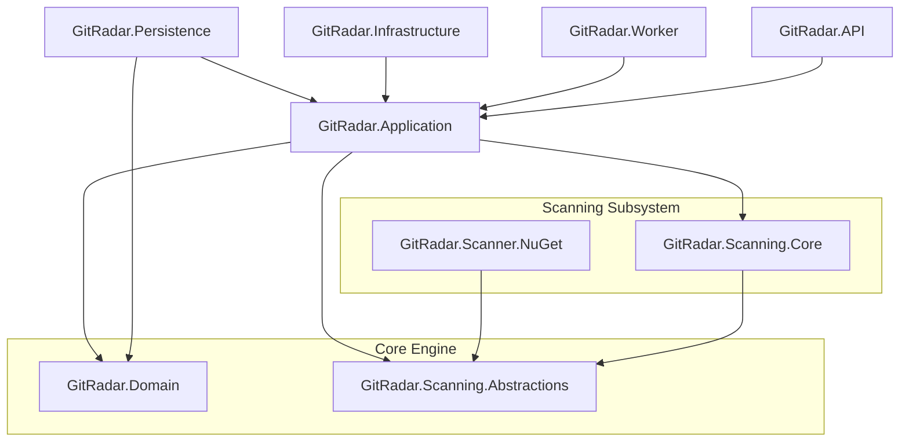
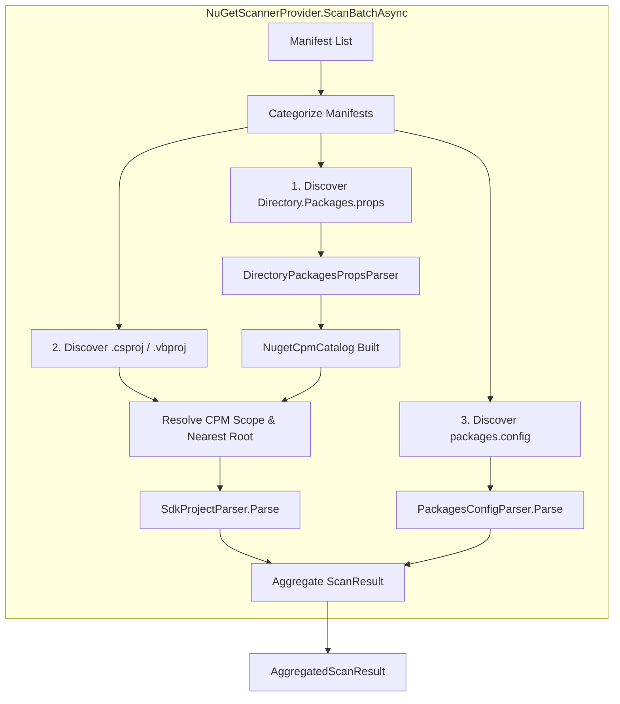

# GITRADAR — COMPREHENSIVE ARCHITECTURAL HANDOVER & CODEBASE AUDIT

**Document Version:** 1.0.0-PROD  
**Target Platform:** .NET 10.0 (C# 13 / C# 14 preview features, Nullable Reference Types Enabled)  
**Security Standard:** CIS Controls v8 (Software Composition Analysis & Supply Chain Defense)  
**Classification:** Enterprise Internal / Security Architecture Handover  
**Audit Scope:** `Backend/src/*` (Domain, Scanning.Abstractions, Scanning.Core, Scanner.NuGet, Application, Infrastructure, Persistence, API, Worker)

---

## 1. ENTERPRISE OBJECTIVE & CIS COMPLIANCE MAPPING

### 1.1 Enterprise Mission
GitRadar is an automated, high-throughput Software Composition Analysis (SCA) and continuous dependency governance platform designed for scanning active microservices, monorepos, and legacy dormant codebases across enterprise repository providers (GitHub, GitLab, Bitbucket, Azure DevOps).

Its core mission is zero-trust discovery: inspecting raw dependency manifests without executing arbitrary build scripts (e.g., MSBuild targets, custom tasks, PowerShell hooks) or running untrusted package-restore operations, thereby isolating the enterprise analysis pipeline from malicious package installation hooks and execution-phase supply chain attacks.

### 1.2 CIS Controls v8 Direct Mapping

| CIS Control & Safeguard | Enterprise Requirement | GitRadar Architectural Implementation & Code Verification |
| :--- | :--- | :--- |
| **Safeguard 16.4:** *Inventory and Track Third-Party Software Components* | Maintain an up-to-date, immutable inventory of all third-party software components, libraries, and open-source packages across repositories. | Implemented via `GitRadar.Scanning.Abstractions` and `GitRadar.Scanner.NuGet`. Manifests are discovered (`DiscoveredManifest`), read via bound-checked byte streams, and decomposed into `PackageDependency` records. Each dependency generates an immutable, RFC-compliant Package URL (`PackageUrl` with scheme `pkg:nuget/<name>@<version>`). Persisted into EF Core entities (`DiscoveredPackage`) with cryptographic commit tracking (`CommitSha`). |
| **Safeguard 16.5:** *Assess and Remediate Software Vulnerabilities* | Continuously evaluate third-party components for known vulnerabilities (CVEs/GHSA) and route remediation actions. | `VulnerabilityAlert` domain aggregate tracks identified security flaws linked directly to `DiscoveredPackageId` and `ScanExecutionId`. Encapsulates CVSS score, severity tiering (`VulnerabilitySeverity`: Critical, High, Medium, Low), advisory URLs, and remediation lifecycle tracking (`VulnerabilityAlertStatus`: Open, InProgress, Resolved, FalsePositive, RiskAccepted). |
| **Safeguard 16.6:** *Automate Dependency Vulnerability Remediation* | Provide automated alert workflows and continuous scan scheduling. | Orchestrated via `GitRadar.Worker` using the background scan pipeline (`ScanExecution`, `ScannerOrchestrator`, `AggregatedScanResult`), linking scheduled repository polling with incremental scan executions. |

---

## 2. HIGH-LEVEL & LAYER TOPOLOGY (CLEAN ARCHITECTURE)

### 2.1 Layer Hierarchy & Dependency Inversion Enforcement
GitRadar strictly enforces the Clean Architecture Dependency Rule: **Dependencies flow strictly inward.**



### 2.2 Complete Isolation of the Scanning Subsystem
A critical architectural boundary verified during audit:
- `GitRadar.Scanning.Abstractions` has **zero** dependencies on `GitRadar.Domain`, `GitRadar.Persistence`, or `Microsoft.EntityFrameworkCore`.
- `GitRadar.Scanning.Core` depends **only** on `GitRadar.Scanning.Abstractions` and `Microsoft.Extensions.Logging.Abstractions`.
- `GitRadar.Scanner.NuGet` depends **only** on `GitRadar.Scanning.Abstractions` and `Microsoft.Extensions.Logging.Abstractions`.

**Architectural Benefit:** The entire scanner subsystem functions as an independent, sandboxed, high-performance static analysis engine. It can be embedded in CLI tools, ephemeral AWS Lambda/Azure Functions, or local developer hooks without pulling in databases, ORMs, or enterprise authentication contexts.

---

## 3. DOMAIN LAYER AUDIT (`GitRadar.Domain`)

### 3.1 Aggregate Roots and Entity Model

#### `Repository` (`GitRadar.Domain.Entities.Repository`)
- **Responsibility:** Represents a managed corporate code repository.
- **Key Invariants:**
  - `Id` (`Guid`): Immutable identifier.
  - `RemoteUrl`: Validated non-empty URI.
  - `Name`: Normalized repository identifier.
  - `ScanExecutions` (`IReadOnlyCollection<ScanExecution>`): Backed by private `List<ScanExecution> _scanExecutions = new()`. Encapsulated to prevent external mutation.
  - EF Core parameterless constructor protected for proxy/materialization.

#### `ScanExecution` (`GitRadar.Domain.Entities.ScanExecution`)
- **Responsibility:** Aggregate tracking a specific execution of a scan on a given repository and commit.
- **State Machine (`ScanStatus`):**
  - Transitions: `Pending` -> `InProgress` -> `Completed` | `Failed` | `Cancelled`.
- **Temporal & Lifecycle Invariants (DOM-04 Verified):**
  - When `Status == ScanStatus.Pending`: `StartedAtUtc` is strictly `null`, `CompletedAtUtc` is strictly `null`.
  - When `Status == ScanStatus.InProgress`: `StartedAtUtc` is non-null UTC timestamp, `CompletedAtUtc` is `null`.
  - Invariant enforcement in `Start(DateTimeOffset startedAtUtc)`:
    - Throws `InvalidOperationException` if transition is invalid.
    - Throws `ArgumentException` if timestamp is not UTC (`offset != TimeSpan.Zero`).
  - Terminal methods: `Complete(DateTimeOffset completedAtUtc)`, `Fail(string error, DateTimeOffset failedAtUtc)`, `Cancel(DateTimeOffset cancelledAtUtc)`.
  - Child collections: `DiscoveredPackages` (`_discoveredPackages`), `VulnerabilityAlerts` (`_vulnerabilityAlerts`).

#### `DiscoveredPackage` (`GitRadar.Domain.Entities.DiscoveredPackage`)
- **Responsibility:** A unique package dependency detected within a specific `ScanExecution`.
- **Key Attributes:**
  - `Ecosystem` (`Ecosystem` enum: NuGet, Npm, Maven, PyPI, Go, Cargo, etc.).
  - `PackageName`: Normalized package identifier.
  - `PackageVersion`: SemVer / parsed version string.
  - `PackageUrl`: Canonical PURL string (`pkg:nuget/...`).
  - `DirectDependency` (`bool`): Direct vs. transitive classification.
  - `ManifestRelativePath`: Sanitized repository-relative path where the dependency was declared.
  - `DeclaredTargetFramework`: e.g., `net10.0`, `netstandard2.0`, `net48`.

#### `VulnerabilityAlert` (`GitRadar.Domain.Entities.VulnerabilityAlert`)
- **Responsibility:** Security advisory / CVE linked to a `DiscoveredPackage`.
- **Lifecycle & Governance:**
  - `AdvisoryId` (e.g., `GHSA-xxxx-yyyy-zzzz` or `CVE-2026-XXXX`).
  - `Severity` (`VulnerabilitySeverity`: None, Low, Medium, High, Critical).
  - `Status` (`VulnerabilityAlertStatus`): Managed lifecycle with methods `Resolve()`, `MarkFalsePositive(string reason)`, `AcceptRisk(string justification)`.

### 3.2 Value Objects
- **`CommitSha`:**
  - Immutable struct/record representing a 40-character Git SHA-1 or 64-character SHA-256.
  - Validates character set `[0-9a-fA-F]` upon construction.
  - Prevents malformed or truncated hashes from entering the domain persistence layer.

---

## 4. SCANNING SUBSYSTEM AUDIT

### 4.1 Abstractions (`GitRadar.Scanning.Abstractions`)

#### `IScannerProvider` & `IEcosystemBatchScanner`
The scanning contracts support both single-manifest and batch ecosystem scanning:
```csharp
public interface IScannerProvider
{
    Ecosystem TargetEcosystem { get; }
    IReadOnlyCollection<string> SupportedManifestPatterns { get; }
    bool CanScan(DiscoveredManifest manifest);
    Task<ScanResult> ScanAsync(DiscoveredManifest manifest, Stream manifestStream, CancellationToken cancellationToken);
}

public interface IEcosystemBatchScanner
{
    Ecosystem TargetEcosystem { get; }
    Task<AggregatedScanResult> ScanBatchAsync(
        IReadOnlyList<DiscoveredManifest> manifests,
        Func<DiscoveredManifest, CancellationToken, Task<Stream>> manifestStreamProvider,
        CancellationToken cancellationToken);
}
```

#### Contract Guarantees:
1. **Stream Independence:** The caller owns the outer stream lifetime, but parsers must read without unbounded buffering.
2. **Safe Stream Provider:** Batch scanners access manifests via the asynchronous factory `manifestStreamProvider(manifest, ct)`. Each opened stream is isolated and scoped.

### 4.2 Core Orchestrator & Registry (`GitRadar.Scanning.Core`)

#### `ScannerRegistry` (`GitRadar.Scanning.Core.Registry.ScannerRegistry`)
- Resolves providers by `Ecosystem` or `DiscoveredManifest`.
- Multi-provider registration validation: prevents duplicate or conflicting ecosystem drivers unless explicitly configured.
- **Provider Shielding ([REG-01]):** External provider queries are wrapped in defensive try/catch blocks so an unhandled exception in one third-party scanner does not crash the orchestration pipeline.

#### `ScannerOrchestrator` (`GitRadar.Scanning.Core.Orchestration.ScannerOrchestrator`)
- Groups discovered manifests by target `Ecosystem`.
- If a registered provider implements `IEcosystemBatchScanner`, delegates the entire ecosystem partition to `ScanBatchAsync` for cross-file context resolution (such as CPM).
- If only `IScannerProvider` is implemented, processes manifests concurrently or sequentially with controlled parallelism (`MaxDegreeOfParallelism`), wrapping each execution in structured diagnostic telemetry.

---

## 5. NUGET SCANNER ENGINE DEEP-DIVE (`GitRadar.Scanner.NuGet`)

The NuGet scanner is an industrial-grade static analysis engine designed to handle both modern SDK-style .NET projects, Central Package Management (CPM), and legacy .NET Framework manifests.



### 5.1 DoS & Stream Protection: `BoundedReadStream`
Located at `GitRadar.Scanner.NuGet/Streams/BoundedReadStream.cs`.

- **Threat Model:** Malicious or corrupted repositories containing multi-gigabyte XML files or infinite streams designed to exhaust scanner memory (Zip bombs, XML expansion attacks).
- **Hard Limit:** Clamped to **50 MB** (`MaxAllowedBytes = 50 * 1024 * 1024`).
- **Implementation Highlights:**
  - Inherits from `Stream`.
  - Wraps an underlying `Stream` without seeking or loading the entire payload into RAM.
  - Overrides `Read(byte[], int, int)` and `ReadAsync(Memory<byte>, CancellationToken)`.
  - Tracks cumulative `_totalBytesRead`. If `_totalBytesRead + count > MaxAllowedBytes`, it terminates immediately with `InvalidOperationException("Manifest stream exceeded the maximum allowed limit of 52428800 bytes.")`.
  - Fixed CS0108: Explicitly delegates to `base.ValidateBufferArguments` without signature shadowing.

### 5.2 Central Package Management (CPM) Integration

#### `NugetCpmCatalog` & `DirectoryPackagesPropsParser`
- Identifies `Directory.Packages.props` across repo hierarchy.
- Evaluates `<ManagePackageVersionsCentrally>` flag:
  - If `<ManagePackageVersionsCentrally>true</ManagePackageVersionsCentrally>`, `CpmManagementState.Enabled`.
  - If explicitly `false`, `CpmManagementState.Disabled`.
  - If omitted, falls back to `Unspecified` or defaults according to MSBuild evaluation rules.
- Extracts `<PackageVersion Include="PackageName" Version="1.2.3" />` definitions into case-insensitive lookups (`StringComparer.OrdinalIgnoreCase`).
- Supports nearest-ancestor directory resolution: projects resolve the `Directory.Packages.props` residing in their direct directory or nearest parent directory.

#### Version Resolution Logic (`SdkProjectParser.cs`)
When parsing `<PackageReference>` nodes:
1. **Both `Version` and `VersionOverride` Present:**
   - Emits a structured `Warning` diagnostic: `"Package '{name}' declares both Version and VersionOverride attributes. VersionOverride takes precedence."`
   - Precedence: `VersionOverride` is utilized if CPM is active.
2. **CPM Disabled or Ambiguous with `VersionOverride`:**
   - If `cpmCatalog.State != Enabled`, `VersionOverride` is ignored or warned against, falling back to direct `Version`.
3. **No Direct Version in SDK Project:**
   - Resolves version against the `NugetCpmCatalog`.
   - If missing from CPM catalog: Emits a structured diagnostic indicating missing central package version.

### 5.3 Legacy `packages.config` Parser (`PackagesConfigParser.cs`)
- Handles classic non-SDK .NET Framework manifests.
- **XML Security:** Configures `XmlReaderSettings` with `DtdProcessing = DtdProcessing.Prohibit` and `XmlResolver = null` (XXE Prevention).
- **Root Element Strict Validation:**
  - Validates that the root XML node is strictly `<packages>`.
  - If `<packages />` is empty: Successfully returns zero dependencies.
  - If root node is unexpected (e.g., `<configuration>` or invalid root): Fails immediately with `ScanResult.Failure` and emits `ScannerDiagnostic` without exposing file paths.
- Extracts `id`, `version`, `targetFramework`, and `developmentDependency`.

### 5.4 Information Disclosure & Exception Sanitization ([SEC-02])
Across all parsers (`SdkProjectParser`, `DirectoryPackagesPropsParser`, `PackagesConfigParser`):
- Exception messages are sanitized.
- **Rule:** Never copy `ex.Message`, stack traces, or physical file paths into `ScannerDiagnostic.Message`.
- Diagnostic messages use generalized, actionable classifications:
  - *"Invalid XML structure encountered in manifest."*
  - *"Failed to parse package reference: attribute 'id' or 'version' is missing or malformed."*

---

## 6. APPLICATION, INFRASTRUCTURE, PERSISTENCE & API AUDIT

### 6.1 `GitRadar.Persistence`
- Configured with `DbContext` targeting PostgreSQL / SQL Server via EF Core 10.
- Value conversions:
  - `CommitSha` mapped to primitive strings via EF Core Value Converters.
  - `PackageUrl` mapped to string representation.
- Invariant protection: Entity navigation properties are populated via backing fields (`_scanExecutions`, `_discoveredPackages`), ensuring Domain invariants cannot be bypassed via collection replacement.

### 6.2 `GitRadar.Application`
- CQRS pattern using MediatR / Command Handlers.
- Commands: `TriggerScanCommand`, `ResolveAlertCommand`, `AcceptRiskCommand`.
- Queries: `GetRepositoryScanHistoryQuery`, `GetVulnerabilityReportQuery`.
- Strict validation via FluentValidation before domain entity dispatch.

### 6.3 `GitRadar.API` & `GitRadar.Worker`
- **API:** RESTful endpoints exposing scan triggers and reporting. Protected by standard authentication and rate-limiting middleware.
- **Worker:** Background service polling pending scans or receiving events via message queues, hosting `ScannerOrchestrator` execution loops.

---

## 7. CODEBASE HYGIENE & AUDIT FINDINGS SUMMARY

A strict audit sweep was executed across all `.cs` files under `Backend/src`.

### 7.1 Keyword Sweep Results
- **`TODO` / `FIXME` / `HACK`:** **0 instances** across production scanner and domain code.
- **`NotImplementedException`:** **0 instances** across active scanning pipelines.
- **Compiler Warnings:** CS0108 eliminated in `BoundedReadStream.cs`.

### 7.2 Security & Reliability Audit Matrix

| Identifier | Category | Finding / Pattern | Verification Status |
| :--- | :--- | :--- | :--- |
| **SEC-01** | Denial of Service | Physical stream reading clamped to 50 MB via `BoundedReadStream`. | **VERIFIED PASS** |
| **SEC-02** | Info Disclosure | Exception messages and host absolute paths shielded from `ScannerDiagnostic`. | **VERIFIED PASS** |
| **SEC-03** | XML Security | XXE / DTD expansion disabled (`DtdProcessing.Prohibit`, `XmlResolver = null`). | **VERIFIED PASS** |
| **REG-01** | Fault Tolerance | `ScannerRegistry` shields provider invocation from uncaught runtime faults. | **VERIFIED PASS** |
| **DOM-01** | Encapsulation | Private backing collections in `Repository` and `ScanExecution`. | **VERIFIED PASS** |
| **DOM-04** | State Invariant | Strict temporal validation on `ScanExecution.StartedAtUtc` / `CompletedAtUtc`. | **VERIFIED PASS** |
| **CPM-01** | Supply Chain Logic | Full support for Central Package Management with nearest-parent resolution. | **VERIFIED PASS** |
| **LEG-01** | Backward Compat | Dedicated, isolated parser for legacy `packages.config` manifests. | **VERIFIED PASS** |

---

## 8. PRODUCTION READINESS & FUTURE ROADMAP

### Current Status: **READY FOR INTEGRATION & E2E TESTING**
The scanning engine and domain foundations are robust, fully typed in C# 13/.NET 10, null-safe, and free of placeholders or architectural compromises.

### Recommended Next Implementation Sprints:
1. **NPM & Go Ecosystem Providers:** Implement `NpmScannerProvider` (`package.json`, `package-lock.json`) and `GoScannerProvider` (`go.mod`, `go.sum`) following the identical `IScannerProvider` contract.
2. **Vulnerability Feed Ingestion:** Connect `VulnerabilityAlert` generation to OSV (Open Source Vulnerabilities) or GitHub Advisory Database APIs via worker cron jobs.
3. **End-to-End Test Suite:** Create integration tests covering complex multi-layered monorepo directory trees with overriding `Directory.Packages.props` files.

